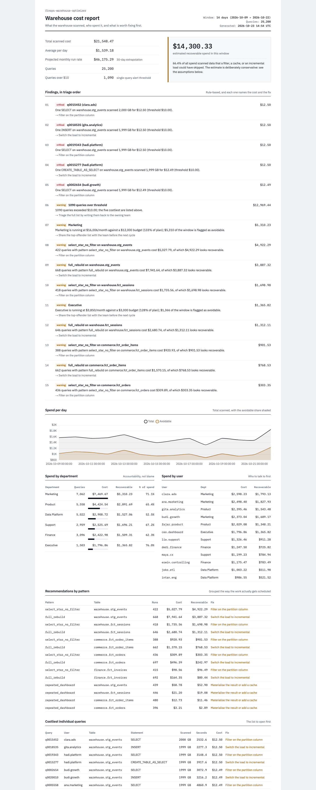

# FinOps Warehouse Cost Optimizer

Attribute every dollar of warehouse spend to the query, the person, and the team that caused it —
then rank what a filter, a cache, or an incremental load would recover.

Cloud bills arrive a month after the damage, in one undifferentiated line. The analyst who ran a
$12 full-table scan at 2am never sees it, the data platform team gets blamed for it, and the only
"reporting" anyone has is the invoice total. This project turns query history into attribution,
findings, and a number a manager can act on — with the assumptions written down.



## What it does

1. **Generates a realistic query history** (or takes a real export): cost follows bytes scanned,
   filtering is two orders of magnitude cheaper, and nightly rebuilds are expensive but legitimate.
2. **Runs six SQL models** in DuckDB — per-query cost, per-department and per-user attribution,
   daily trend, recommendations grouped by pattern, and the costliest individual queries.
3. **Applies a published cost model**, so every savings figure traces back to a stated assumption
   instead of a vibe.
4. **Raises three kinds of finding**: a single query over a per-query threshold, a department
   heading past its monthly budget, and a pattern-and-table pair carrying a lot of avoidable spend.
5. **Renders a static report** and returns a distinct exit code for scheduled jobs, so the same
   run can drive a dashboard, a weekly digest, or a CI gate.

## Quickstart

```bash
python3 -m venv .venv
.venv/bin/pip install -e '.[dev]'

# 1. build a query history (seeded and deterministic)
python scripts/generate_query_history.py

# 2. score it, raise findings, write the report
.venv/bin/python -m finops_optimizer.cli --input data/query_history.json
```

```text
14 days, 25,200 queries, $21,548.47 scanned
  run rate        $46,175 / month
  recoverable     $14,300.33 (66.4% of spend, by the stated assumptions)
  queries over $10  1,090

15 finding(s):
  [critical] q0015452 (clara.ads): One SELECT on warehouse.stg_events scanned 2,000 GB for $12.50 (threshold $10.00).
  [critical] q0018535 (gita.analytics): One INSERT on warehouse.stg_events scanned 1,999 GB for $12.50 (threshold $10.00).
  ...
  [warning ] 1090 queries over threshold: 1090 queries exceeded $10.00; the five costliest are listed above.
  [warning ] Marketing: Marketing is running at $16,006/month against a $12,000 budget (133% of plan); $5,310 of the window is flagged as avoidable.
  [warning ] select_star_no_filter on warehouse.stg_events: 422 queries ... $4,922.29 looks recoverable.
```

The report lands at `docs/generated/finops-report.html`. Add `--fail-on-critical` for a scheduled
job that should alert (exit code 3), or `--json` to pipe the payload somewhere else.

A committed sample is also available if you would rather not generate anything first:
`--input samples/query_history_small.json` (120 queries, one day, seed 11).

## The cost model, and why it is written down

Every recommendation is an estimate. Pretending otherwise is how cost reports lose credibility,
so the assumptions are configuration and they appear in the report's methodology block:

| Assumption | Default | Why |
| --- | --- | --- |
| `price_per_tb_usd` | 6.25 | On-demand list price: you pay for bytes scanned |
| `filter_selectivity` | 0.02 | A partition filter reads days, not months |
| `materialization_reduction` | 0.90 | A cached dashboard stops rescanning its source |
| `incremental_reduction` | 0.50 | Half of a full rebuild is realistically removable |
| `single_query_alert_usd` | 10.00 | One query worth a conversation |

`select_star_no_filter` means a `SELECT` skipped a filter that existed on its table. A
`full_rebuild` is *not* called waste: it is labelled as reviewable, because an incremental load
would be cheaper but the nightly build itself is real work. Queries with no defensible
recommendation report a saving of exactly zero.

## SQL models

| Model | Answers |
| --- | --- |
| `cost_per_query` | What did this query cost and what would fix it? |
| `cost_by_department` | Which team spends, and how much of it is recoverable? |
| `cost_by_user` | Who to talk to first (framed as coaching, not blame) |
| `daily_trend` | Spend over time with the avoidable share separated |
| `recommendations` | Which pattern-and-table pairs to schedule work on |
| `top_offenders` | The individual queries to open first |

They are plain `.sql` files, executed in filename order, with the pricing injected as template
values so it is never copy-pasted into SQL.

## Alert rules

| Rule | Severity | Fires when |
| --- | --- | --- |
| `single_query_over_threshold` | critical | One query costs more than the per-query threshold |
| `department_budget_breach` | warning / critical | Run rate is over budget, and 1.5x over is a page |
| `dominant_avoidable_pattern` | warning | One pattern on one table carries a large recoverable amount |

Findings are ordered by severity and then by cost, so the first line of the output is the one that
matters. A rule that fires for hundreds of queries is summarised once rather than repeated — the
same alert-fatigue problem the [AI pipelines alerts](https://github.com/faishalnuruz/aiops-pipeline-alerts)
project solves for incidents.

## Tests

```bash
.venv/bin/python -m pytest -q    # 38 passed
.venv/bin/ruff check .
```

The suite covers the cost maths and each savings assumption, generator invariants (a query is only
flagged avoidable when a filter genuinely existed and was skipped; rebuilds are never labelled
waste), model reconciliation (per-query totals equal the department and trend totals), alert
severity and ordering, JSON safety (missing values become `null`, never `NaN`), and the CLI
including its exit codes.

## Deliberate limitations

- **The history is synthetic.** The generator is seeded and its economics are documented, but no
  real warehouse is behind it. Pointing it at a real export is the first task below.
- **Cost is modelled as bytes scanned only.** Warehouse-uptime pricing (Snowflake credits per
  second, slot time in BigQuery reservations) is a different model, and mixing the two would be
  wrong.
- **Savings are directional, not booked.** They estimate what a fix would recover under the stated
  assumptions; they are not invoices already cancelled.
- **The report is a snapshot.** It has no history of previous runs, so it cannot show whether spend
  is trending better after a fix. Storing each run would fix that.
- **Budgets are flat monthly numbers** and do not model committed-use discounts, which change what
  "over budget" means at the end of a term.

## Next

1. **Point it at real history** — `INFORMATION_SCHEMA.JOBS` (BigQuery) or
   `SNOWFLAKE.ACCOUNT_USAGE.QUERY_HISTORY`, with the same models unchanged.
2. **Add a weekly digest** — reuse the alerting project to post the top three findings to the
   owning team's channel every Monday.
3. **Gate the pull request** — fail a CI check when a new query scans a partitioned table without
   a filter, which prevents the next incident instead of reporting it.
4. **Persist runs** for trend analysis, so a saving can be proven rather than estimated.
